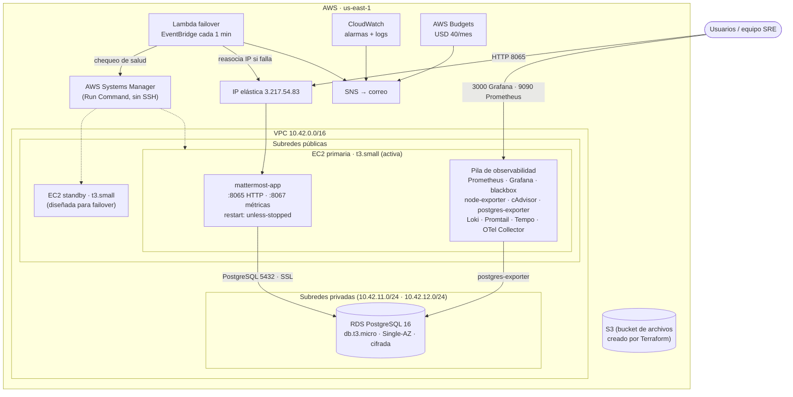
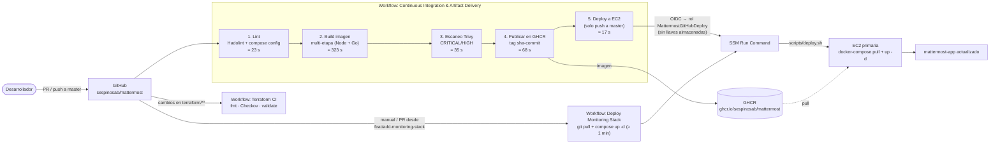
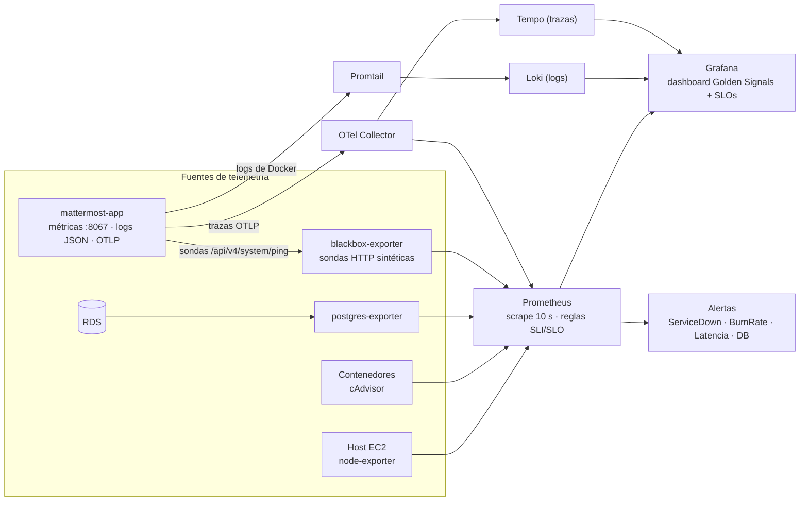

# Arquitectura de la plataforma — Mattermost en AWS

Diagramas construidos a partir de Terraform, de lo que corre realmente en la EC2 primaria (verificado por SSM el 6 de noviembre de 2026) y de los workflows de GitHub Actions. Los diagramas usan [Mermaid](https://mermaid.js.org/), que GitHub renderiza directamente.

## 1. Vista general de infraestructura (AWS `us-east-1`)

**Notas**
- El tráfico de usuarios entra por la IP elástica al puerto 8065 de la EC2 primaria. No hay balanceador ni NAT Gateway (decisión de costo).
- Mattermost, Prometheus, Grafana y los exporters comparten una red Docker (`mattermost_mattermost_network`) dentro de la primaria, por lo que se resuelven por nombre (`mattermost-app`, `mattermost-prometheus`…).
- El acceso administrativo a las instancias es solo por SSM; no se abre SSH.
- La standby está diseñada para recibir la IP elástica cuando el Lambda detecta la primaria caída. Su estado operativo se describe en el [Pre-Mortem](PRE-MORTEM.md) (hecho H1).
- Terraform crea un bucket S3 para archivos, pero el `docker-compose.yml` que despliega el CI/CD configura `MM_FILESETTINGS_DRIVERNAME=local` (volumen Docker en la instancia).

## 2. Flujo de CI/CD (GitHub Actions → AWS)

**Notas**
- Duración total medida del pipeline principal: **≈ 479 s (8 min)** (ejecución del 6 de noviembre de 2026, sin errores).
- La autenticación hacia AWS usa OIDC (identidad federada); no hay claves de larga duración en GitHub.
- El despliegue a EC2 no abre puertos adicionales: usa SSM Run Command.
- Terraform tiene su propio workflow de validación; el `plan` con OIDC solo corre en una rama de infraestructura.

## 3. Flujo de observabilidad

**Las cuatro señales doradas en el dashboard:** tráfico (req/s), latencia (ms), errores (tasa de fallos y consumo de Error Budget) y saturación (CPU/memoria del host y de los contenedores), más el estado de la dependencia PostgreSQL.

## 4. Inventario de componentes

| Capa | Componente | Detalle |
|---|---|---|
| Aplicación | Mattermost | Contenedor `mattermost-app`, imagen en GHCR, reinicio automático |
| Datos | RDS PostgreSQL | `mattermost-postgres`, versión 16, Single-AZ, 20 GB, cifrada, backups de 1 día |
| Cómputo | EC2 `t3.small` ×2 | Primaria (activa) y standby (diseñada para failover) |
| Red | VPC | `10.42.0.0/16`, 2 subredes públicas y 2 privadas, IP elástica |
| IaC | Terraform | Módulos `network`, `security`, `compute`, `database`, `storage`, `observability`, `failover` |
| CI/CD | GitHub Actions | Lint → build → escaneo → publicación → despliegue por OIDC + SSM |
| Observabilidad | Prometheus, Grafana, Loki, Tempo, OTel | Métricas, logs estructurados y trazas |
| Alertamiento | Prometheus + CloudWatch + SNS | Burn rate multi-ventana, servicio caído, latencia, BD, saturación |
| Resiliencia | Lambda de failover | Chequeo de salud por SSM cada minuto |
| Costos | AWS Budgets | Umbral de USD 40/mes con avisos al 50 %, 75 % y 90 % |
